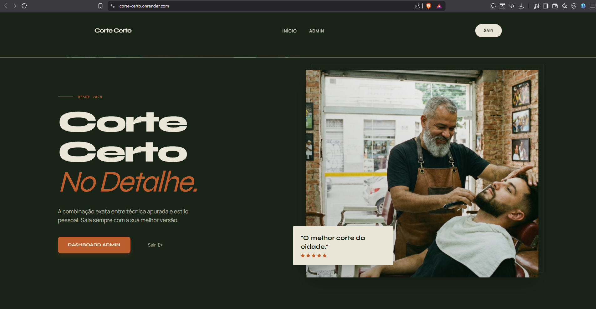
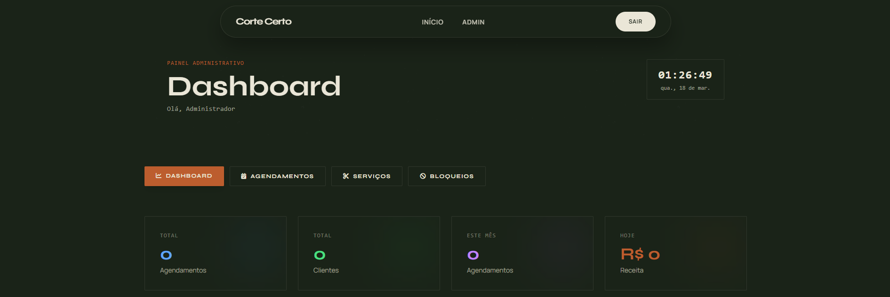
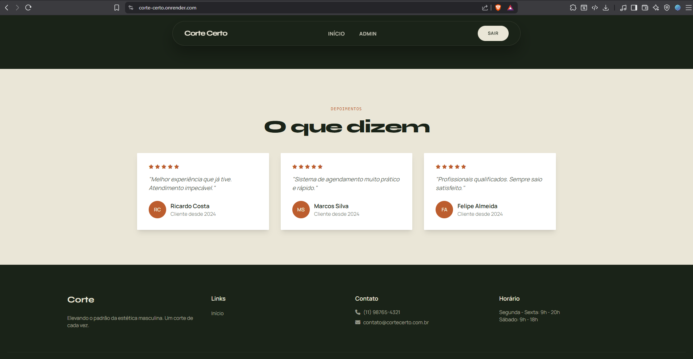

# ✂️ Corte Certo — Sistema de Agendamento para Barbearias

Sistema web full-stack de agendamento online para barbearias, com painel administrativo e área do cliente. Desenvolvido com **Flask**, **SQLAlchemy** e **Tailwind CSS**, seguindo o padrão **MVC** com Flask Blueprints.

> 🔗 **Demo:** [cortecerto-app.vercel.app](https://cortecerto-app.vercel.app) — na tela de login, use **Entrar como cliente demo** ou **Entrar como admin demo** para conhecer o sistema sem criar conta.

---


## 📱 Telas do Sistema

### Página Inicial da Barbearia


### Dashboard Administrativo


### Depoimentos


---

## �🖼️ Visão Geral

- **Página pública** com apresentação da barbearia e call-to-action para cadastro
- **Área do cliente** para agendar, visualizar e cancelar horários
- **Painel admin** com dashboard de métricas, gestão de serviços, agendamentos e bloqueios de agenda
- **API interna** para consulta dinâmica de horários disponíveis

---

## 🛠️ Tech Stack

| Camada | Tecnologia |
|---|---|
| **Backend** | Python 3 · Flask 3 · SQLAlchemy ORM |
| **Frontend** | Jinja2 · Tailwind CSS · JavaScript · GSAP |
| **Banco de Dados** | PostgreSQL (produção) · SQLite (dev) |
| **Segurança** | Werkzeug (hash de senhas) · Session-based auth · Decorators de autorização |
| **Deploy** | Vercel (Python serverless) · Supabase (PostgreSQL) |

---

## 📁 Arquitetura (MVC)

```
Corte-Certo/
├── app.py                          # Entry point — inicialização e registro de Blueprints
├── config.py                       # Configurações e variáveis de ambiente
├── models.py                       # Model — entidades do banco (ORM)
├── decorators.py                   # Middlewares de autenticação/autorização
├── demo.py                         # Contas de demonstração (cliente e admin)
├── utils.py                        # Funções utilitárias e validações
│
├── controllers/                    # Controller — lógica de negócio por domínio
│   ├── main_controller.py          #   Página inicial
│   ├── auth_controller.py          #   Login, cadastro, logout
│   ├── admin_controller.py         #   Dashboard, serviços, agendamentos, bloqueios
│   ├── cliente_controller.py       #   Agendar, cancelar, histórico
│   └── api_controller.py           #   API JSON (horários disponíveis)
│
├── templates/                      # View — templates Jinja2
│   ├── base.html                   #   Layout principal
│   ├── index.html                  #   Landing page
│   ├── login.html / cadastro.html  #   Autenticação
│   ├── admin/                      #   Painel administrativo
│   └── cliente/                    #   Painel do cliente
│
├── static/                         # Assets estáticos
│   ├── css/ · js/ · images/
│
├── requirements.txt                # Dependências Python
├── .python-version                 # Versão do Python usada no deploy
├── vercel.json                     # Cron diário de verificação do banco
└── .env.example                    # Modelo das variáveis de ambiente
```

---

## ⚙️ Funcionalidades

### Cliente
- Cadastro e login com validação de senha forte
- Contas de demonstração (cliente e admin) com dados de exemplo, acessíveis com um clique
- Agendamento online com verificação de disponibilidade em tempo real
- Cancelamento de agendamentos (mínimo 2h de antecedência)
- Histórico completo de agendamentos

### Administrador
- Dashboard com métricas: agendamentos do dia, receita, serviços mais populares
- CRUD completo de serviços (preço, duração, ativar/desativar)
- Gestão de agendamentos com filtros por data e status
- Bloqueio de agenda por período com cancelamento automático de agendamentos afetados

### Segurança
- Hash de senhas com Werkzeug (bcrypt)
- Decorators `@login_required` e `@admin_required` para proteção de rotas
- Sanitização de inputs contra XSS
- Proteção contra SQL Injection via ORM
- Validação server-side de todas as regras de negócio

---

## 🚀 Instalação Local

```bash
# Clonar o repositório
git clone https://github.com/Guilherme7K/Corte-Certo.git
cd Corte-Certo

# Criar e ativar environment
python -m venv venv
venv\Scripts\activate  # Windows

# Instalar dependências
pip install -r requirements.txt

# Configurar variáveis de ambiente
cp .env.example .env
# Editar .env com sua SECRET_KEY e DATABASE_URL (opcional)

# Rodar a aplicação
python app.py
```

O servidor inicia em `http://localhost:5000`. O banco SQLite é criado automaticamente com dados de exemplo.

**Login padrão admin:** `admin@cortecerto.com` / `admin123` (é a mesma conta do botão "Entrar como admin demo")

---

## 📦 Deploy (Vercel + Supabase)

O app roda como função Python serverless na Vercel, que detecta o Flask pelo `app.py`. O banco é PostgreSQL no Supabase.

1. No Supabase, copie a URL do **Transaction pooler** (botão *Connect*, porta `6543`). A conexão direta (`db.<ref>.supabase.co:5432`) usa só IPv6 e não funciona na Vercel.
2. Crie as tabelas e os dados iniciais uma única vez, apontando para o Supabase:
   ```bash
   # com DATABASE_URL do Supabase no .env
   flask --app app init-db
   ```
3. Importe o repositório na Vercel e configure as variáveis de ambiente:

| Variável | Obrigatória | Descrição |
|---|---|---|
| `DATABASE_URL` | Sim | URL do pooler do Supabase: `postgresql://postgres.<ref>:<senha>@aws-0-<regiao>.pooler.supabase.com:6543/postgres` |
| `SECRET_KEY` | Sim | Chave para assinar a sessão. Gere com `python -c "import secrets; print(secrets.token_hex(32))"` |

O deploy é automático a cada push na `main`. Sem essas variáveis o app não inicia em produção, de propósito, para não cair em SQLite ou em uma chave padrão.

O `vercel.json` agenda um cron diário que chama a rota `/saude`, que faz uma consulta simples no banco. Isso confirma que a conexão está funcionando e evita que o Supabase gratuito pause o projeto por inatividade.

---

## 📝 Licença

Este projeto foi desenvolvido para fins de estudo e portfólio.
